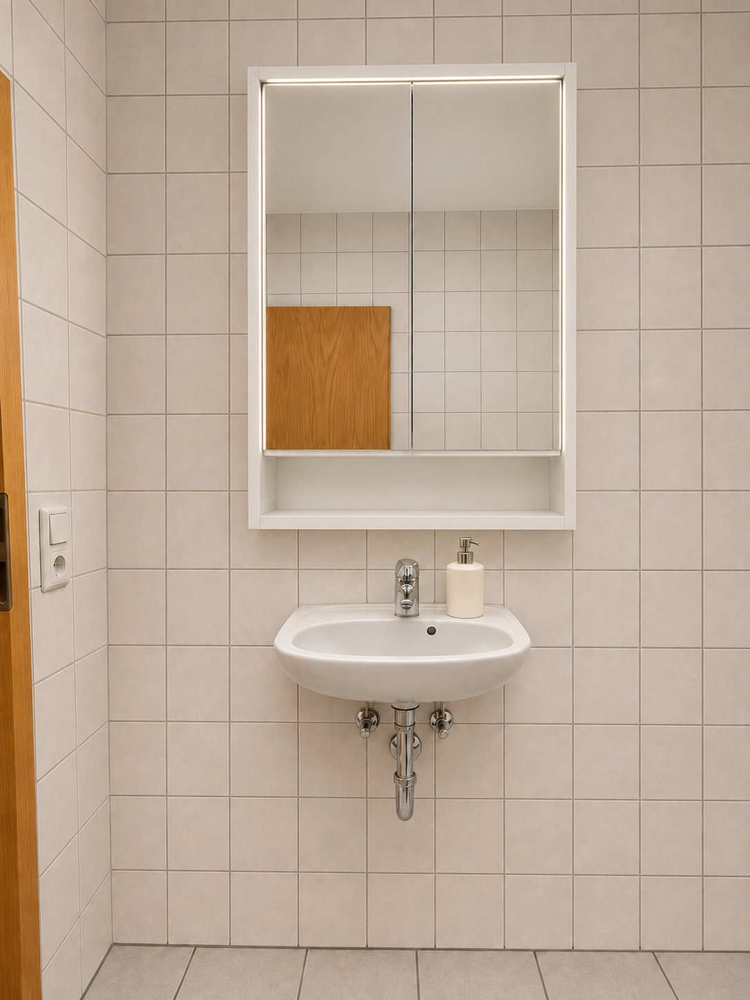
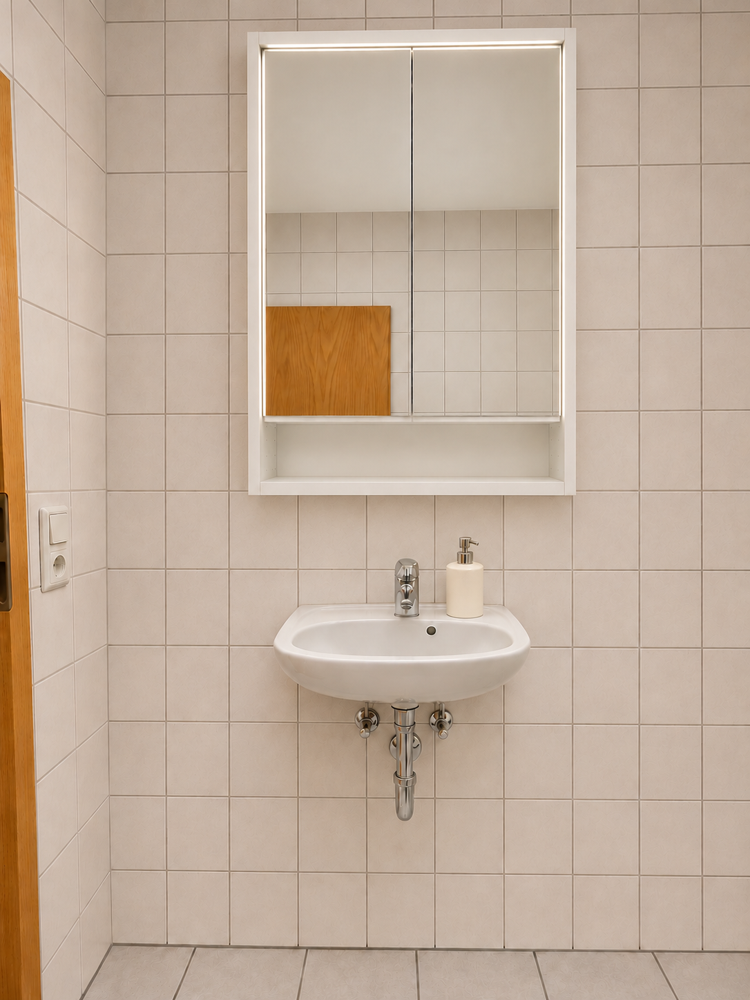
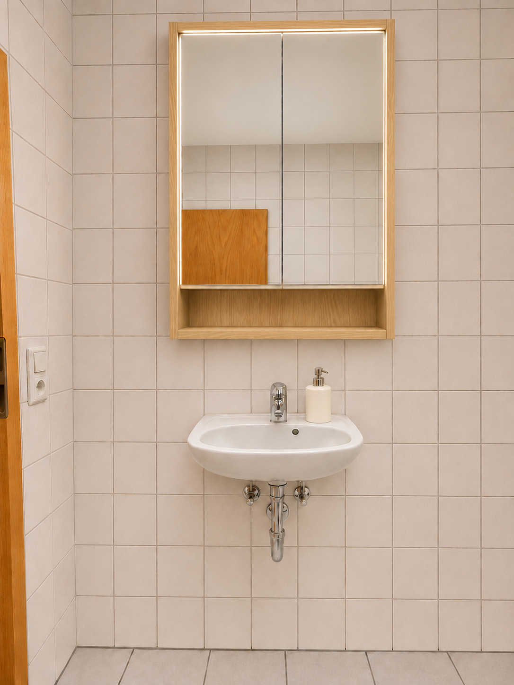
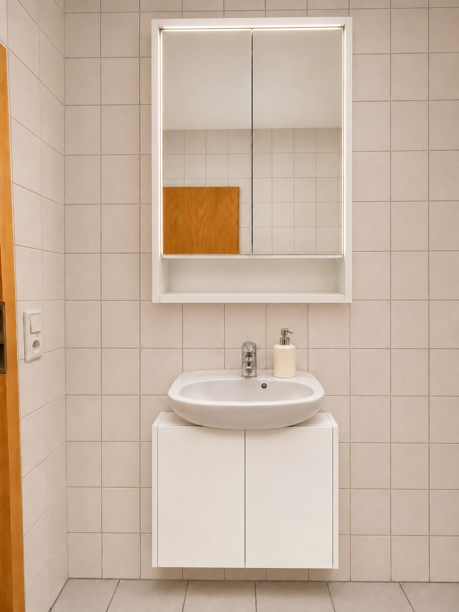
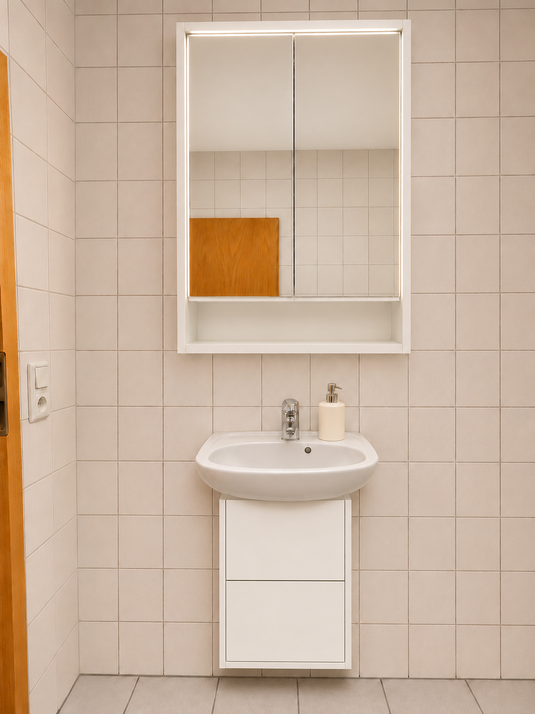

# Waschplatz – Optikvarianten

KI-generierte Ansichten auf Grundlage der Nutzerfotos und Produktbilder. Sie dienen zum Vergleich der Gestaltung, nicht als maßstäbliche Montagezeichnung. Schrankgröße laut Nutzer: 60 × 15 × 95 cm; Beckenbreite 50 cm. Ziel ist ein mittiger Sitz mit jeweils 5 cm seitlichem Überstand.

## Weiß

Aufgehellter Raum, ohne Handtuch und bisherige separate Wandleuchte. Dezente integrierte Lichtleisten oben und seitlich entsprechend dem ergänzten Produktfoto; keine leuchtende Unterkante.

## Weiß, höher gesetzt

Auf Nutzerwunsch optisch etwa 8–10 cm höher angeordnet. Die endgültige Montagehöhe ist noch nicht festgelegt.

## Eichenachbildung, höher gesetzt

Gleiche Anordnung, Korpus und offenes Fach entsprechend dem weiteren Produktbild in Eichenachbildung. Zum Vergleich erstellt; für die weitere Planung wurde inzwischen der weiße Spiegelschrank gewünscht.

## Weißer Spiegelschrank mit breitem Unterschrank

Nutzerangaben zum Unterschrank: **60 × 32 × 60 cm (Breite × Tiefe × Höhe)**. Zwei Türen wie im Produktbild; für die Vorschau wandhängend dargestellt. Bei mittiger Anordnung ist er nominell ebenso breit wie der Spiegelschrank und steht am 50 cm breiten Becken jeweils 5 cm seitlich über.

## Weißer Spiegelschrank mit schmalem Unterschrank

Nutzerangaben zum Unterschrank: **40 × 33 × 63 cm (Breite × Tiefe × Höhe)**. Zwei übereinanderliegende Schubladen wie im Produktbild; für die Vorschau wandhängend dargestellt. Das vorhandene 50 cm breite Becken steht nominell jeweils 5 cm über die Schrankseiten hinaus.

Die beiden Vorschauen vom 8. November 2026 vergleichen die Optik mit demselben weißen Spiegelschrank in der höheren Position. Noch kein Unterschrank ausgewählt. Die Bilder bestätigen weder Beckenauflage noch Siphon-/Ventilfreiheit oder die Befestigung. Insbesondere bei den Schubladen muss die tatsächliche Innenaufteilung mit den vorhandenen Rohren abgeglichen werden.
